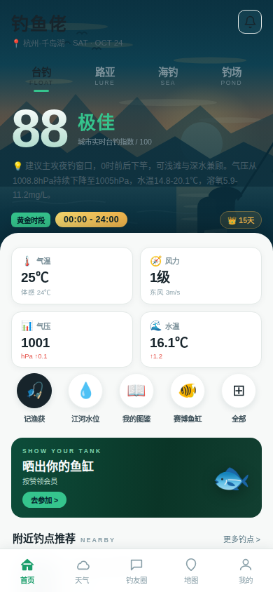
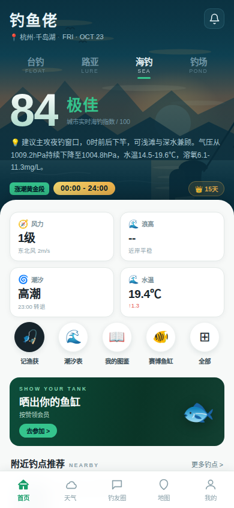
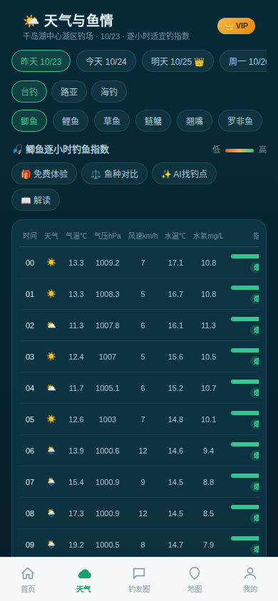

# 🎣 鱼情预报 App（全栈可运行版 · 高级感视觉体系 v4.0）

以「鱼情预报」为核心、结合钓点地图与渔获社区的钓鱼 App。
本仓库按《钓鱼鱼情预报 App 需求文档 v1.0》实现的**可运行全栈版本**：后端 API + MySQL 8 数据库 + Redis 缓存 + 移动端 App 界面，一条命令即可启动体验。

**v3.0 竞品对齐版**：在 v2 全部功能不变的前提下，参照竞品将首页重构为**单页聚合首页**——品牌头 + 钓法四段（台钓/路亚/海钓/钓场）+ 大评分区 + 多段黄金时段胶囊 + 动态指标四格 + 五快捷入口 + TANK 横幅 + 附近钓点推荐一屏聚合；底部 Tab 改为 **首页 / 天气 / 钓友圈 / 地图 / 我的**。四格指标随钓法动态切换（路亚看溶氧、海钓看潮汐浪高），海钓模式自动拉取潮汐表并判定涨潮黄金段。既有能力（溶氧透出、15 天鱼口趋势、100 种鱼图鉴、鱼石积分、赛博鱼缸、潮汐查询、钓鱼百科）全部保留（详见「八、追加需求实现清单」）。

**v3.1 视觉统一版**：整体 UI 与首页浅色面板统一（浅灰底 + 白色卡片 + 深色文字 + 绿色强调），并新增全套 DOM 进出场动画——页面切换淡入上移、内容块依次浮现（stagger）、底部 Tab 选中图标弹跳、底部弹层（Sheet）滑入滑出、首页 hero 元素依次入场。地图与登录页保留深青水域色调以维持视觉层次。

**v4.0 高级感视觉体系**：按参考版式重做五个页面的信息排布，并建立统一设计系统——暖纸白底（#f0f1ec）+ 大圆角白卡（22–28px）+ 宋体黑标题（Noto Serif CJK SC 900）+ 酸性黄绿点缀（#d8f84f）+ 墨绿深色区（#0d1a15）+ 精细线性图标（1.7px）。首页新增「最新渔获 LATEST 双列 + 本地热门鱼种三列」；天气页改为「大温度 + 四环仪表 + 今日鱼情环形分 + 24h 柱状图」；钓友圈改为「书法标题 + 四段黑色选中筛选 + 双列影像瀑布流（鱼种/钓法/重量/热度指数）」；地图改为「搜索胶囊 + 水滴 marker + 右侧竖排控件 + AI 找钓点胶囊 + 底部三统计」；我的改为「深色头图 + 头像等级环 + VIP 深色卡 + 钓鱼档案六宫格 + 鱼缸缩略 + 黄绿 CTA」。渔获影像统一为深墨青水底 + 鱼形剪影 + 水纹，避免占位图与卡片信息重复。

## 一、快速启动

```bash
# 1. 安装数据库（如未安装）
sudo apt-get install -y mysql-server redis-server
sudo service mysql start
redis-server --daemonize yes

# 2. 初始化数据库和演示数据
mysql -e "CREATE DATABASE IF NOT EXISTS fishing_app DEFAULT CHARACTER SET utf8mb4;
          CREATE USER IF NOT EXISTS 'fishing'@'localhost' IDENTIFIED WITH mysql_native_password BY 'fishing123';
          GRANT ALL PRIVILEGES ON fishing_app.* TO 'fishing'@'localhost'; FLUSH PRIVILEGES;"
cd backend && npm install && npm run seed

# 3. 构建前端 + 启动后端（单端口 :3000，API 与 App 同源）
cd ../frontend && npm install && npm run build
cd ../backend && npm start
```

启动后访问 **http://localhost:3000**（桌面浏览器中呈现手机壳形态，手机浏览器直接全屏）。

**演示账号**：手机号 `13800138000`，验证码 `123456`（开发模式固定，任何手机号均可登录/自动注册）。

> 也可以使用 `bash start.sh` 一键完成上述步骤。

## 二、界面演示（v4.0 高级感视觉体系 · 五页版式重排）

| 首页 · 台钓 | 首页 · 路亚 |
|---|---|
|  |  |

| 首页 · 海钓 | 首页 · 钓场 |
|---|---|
|  |  |

| 天气与鱼情（含溶氧列） | 底部 Tab：首页/天气/钓友圈/地图/我的 |
|---|---|
|  | 见各首页截图底部导航栏 |

> v2 布局截图（天气预报 / 钓鱼指数 / 钓友圈 / 发现钓点 / 个人中心 / 15 天趋势 / 鱼种图鉴 / 鱼种对比）保留在同目录 `v2-` 前缀文件中；v1 布局截图保留 `1-` ~ `6-` 前缀。
> 单文件交互演示页：`demo.html`（浏览器直接打开，含可点击 Tab 栏与四钓法截图）。

## 三、已实现功能（对照需求文档）

| 文档章节 | 实现情况 |
|---|---|
| FR-01 鱼情预报 | ✅ 逐小时 0-100 开口概率、等级（冷/一般/较好/窗口期）、最佳时间窗、Top 2-3 影响因子解释、免责声明 |
| FR-02 天气与气压 | ✅ 逐小时温度/气压/风速风向/降水/湿度/云量/露点/日出日落/月相；过去 24h 气压趋势曲线；Redis 缓存 TTL 1h + 0-30s jitter，客户端不直连第三方 |
| FR-03 钓点地图 | ✅ 交互地图、Marker 点聚合（缩放 ≥2x）、按水域类型/距离筛选；详情含禁钓状态（红色前置）、可靠性等级、费用、水深、一键导航；UGC 上报+审核数据模型 |
| FR-04 渔获社区 | ✅ 图文动态、鱼种/饵料标签、关联钓点、动态按钓点聚合、评论/点赞/举报；发布主链路机审（高风险拦截/中风险人工队列/低风险先发后审） |
| FR-05 个人渔获日志 | ✅ 日期/钓点/天气快照/饵料/渔获/备注、公开/私密 visibility，自动附带天气快照为模型校准积累数据 |
| FR-06 会员增值 | 📋 v1.1 规划（界面已展示规划说明，MVP 未实现） |
| NFR-01 性能 | ✅ 鱼情接口 P95 ≈ 40ms（≤800ms 红线）；前端构建产物 gzip ≈ 408KB |
| NFR-02 可靠性 | ✅ 天气多数据源降级（和风 API → 模拟器）、缓存雪崩防护、降级结果标注 |
| NFR-03 安全合规 | ✅ JWT 鉴权、登录/发帖限频、UGC 机审主链路、举报入口、权限与隐私说明、预测免责声明 |
| NFR-04 兼容性 | ✅ 移动端视口 + 触控交互 |
| 数据模型 | ✅ 7 张表 + 鱼种配置表，DDL 与文档第六节一致（见 `backend/src/db/schema.sql`） |
| API 契约 | ✅ 第七节全部接口 + 评论/点赞/举报/日志/上传/配置等补充接口（见 `docs/API.md`） |
| 鱼情引擎 v1 | ✅ 第八节六因子加权规则、按鱼种 JSON 配置加鱼种不改代码、快照入库（见 `docs/鱼情引擎说明.md`） |

## 四、技术栈与需求文档的映射

需求文档面向 Flutter + Spring Boot 原生 App。本仓库为**沙箱环境可落地的等价实现**，架构、API 契约、数据模型、算法规则与文档 1:1 对齐，可平滑迁移：

| 需求文档 | 本仓库实现 | 迁移说明 |
|---|---|---|
| Flutter + Dart 3（5 Tab） | React 18 + Vite（同 5 Tab、同交互流程） | API 契约不变，Flutter 端按 `docs/API.md` 重写 UI 即可 |
| Spring Boot 3.4 + JDK 17 | Node.js 22 + Express（Package by Feature） | 模块划分、DTO、异常模型一致；RFC 7807 ProblemDetails 统一错误 |
| MySQL 8 | MySQL 8（schema.sql 即文档 DDL） | 无需迁移 |
| Redis | Redis（ioredis，TTL+jitter，异常降级内存缓存） | 无需迁移 |
| 和风天气 Web API | 同结构客户端 + 内置模拟数据源 | 配置 `HEFENG_API_KEY` 环境变量即切换真实 API，客户端无感 |
| 高德地图 Flutter 插件 | SVG 交互地图（水域底图/Marker/聚合/筛选/导航 URI） | 导航链接即为高德 URI Scheme，Flutter 端换成插件即可 |
| fl_chart | ECharts 5（概率曲线/气压趋势） | 数据接口相同 |
| 阿里云 OSS STS 直传 | 本地 multer 存储，返回结构一致（`{url}`） | 换成 STS 直传即可 |
| 阿里云内容安全 SDK | 可插拔机审服务（敏感词+图片名+确定性抽检） | 换成 SDK 调用即可 |
| 极光 JPush | 用户表预留 `jpush_rid` 字段 | 接入 SDK 即可 |

## 五、目录结构

```
fishing-app/
├── backend/                      # Node.js 后端（Package by Feature）
│   ├── src/
│   │   ├── index.js              # 入口：API + 静态托管 + 统一异常
│   │   ├── config/               # 环境配置
│   │   ├── db/                   # pool / schema.sql / seed
│   │   ├── cache/redis.js        # Redis 封装：TTL+jitter+内存降级
│   │   ├── middleware/           # JWT 鉴权 + RFC 7807 错误处理
│   │   ├── modules/
│   │   │   ├── auth/             # 手机号+验证码登录（JWT）
│   │   │   ├── spots/            # 钓点列表/详情（距离计算）
│   │   │   ├── weather/          # 和风客户端 + 模拟器 + 缓存服务
│   │   │   ├── forecast/         # 鱼情引擎 + 预报服务（三级缓存）
│   │   │   ├── catches/          # 渔获动态 + 内容安全审核
│   │   │   ├── comments/ likes/ reports/ logs/ upload/ config/
│   │   └── utils/                # geo / hash / async-handler
│   └── uploads/                  # 图片存储（OSS 模拟）
├── frontend/                     # React 移动端 App
│   └── src/
│       ├── App.jsx               # 5 Tab 框架 + 登录
│       ├── api.js / store.jsx    # API 客户端（JWT）+ 全局状态
│       ├── theme.css             # 深水色 + 自然绿主题
│       ├── components/           # UI 组件 + ECharts 图表
│       └── pages/                # 预报/钓点/社区/日志/我的/发布
└── docs/
    ├── API.md                    # API 契约
    └── 鱼情引擎说明.md            # 引擎规则与配置
```

## 六、演示动线建议

1. **登录**：手机号 `13800138000` + 验证码 `123456`
2. **首页 Tab**：看大评分/段位 → 切钓法四段（台钓/路亚/海钓/钓场，四格指标随之变化）→ 点黄金时段胶囊看解读 → 五快捷入口（记渔获/江河水位/我的图鉴/赛博鱼缸/全部）→ TANK 横幅 → 附近钓点推荐
3. **天气 Tab**：日期条切换（昨天置灰/明天起 VIP）→ 鱼种 chips →「⚖️ 鱼种对比」叠加 3 种 →「📖 解读」看因子拆解
4. **钓友圈 Tab**：五级筛选 → 六大快捷入口（百科/潮汐/渔具）→ ➕ 发布渔获（+5 鱼石）
5. **地图 Tab**：点 marker 看详情 → 拖拽平移 → 长按地图收藏 → 合规/卫星/历史影像切换
6. **我的 Tab**：战绩四格 →「📖 我的图鉴」看 X/100 → 赛博鱼缸 → 会员卡「开通会员」模拟激活

> 内容安全演示：发布时正文包含「违规测试」将被机审拦截（422）；正常内容即时展示。

## 七、环境变量（backend/.env）

| 变量 | 说明 | 默认 |
|---|---|---|
| `PORT` | 服务端口 | 3000 |
| `DB_*` | MySQL 连接 | fishing/fishing123/fishing_app |
| `REDIS_URL` | Redis 连接 | redis://127.0.0.1:6379 |
| `JWT_SECRET` | JWT 密钥（生产必须更换） | dev-only-secret-change-me |
| `HEFENG_API_KEY` | 和风天气 Key（留空用模拟数据源） | 空 |
| `NODE_ENV` | development 时验证码固定 123456 | development |

## 八、追加需求实现清单（v4.0）

在 v1 / v2 全部功能**不变**的前提下，按竞品参考截图实现的追加需求：

### 8.0 单页聚合首页（v3 核心改版）

| 区块 | 实现要点 |
|---|---|
| 品牌头 | 钓鱼佬（楷体）+ 城市·星期·日期（FRI · OCT 23 英文缩写）+ 通知铃铛（通知 Sheet） |
| 钓法四段 | 台钓 FLOAT / 路亚 LURE / 海钓 SEA / 钓场 POND，选中态绿色下划线，切换后鱼种与指标联动重置 |
| 大评分区 | 超大数字评分 + 段位（≥78 极佳 / ≥68 良好 / ≥52 一般）+「城市实时{X}钓指数 /100」+ 💡 AI 建议文案（含气压/水温/溶氧解读） |
| 顶部图片背景 | `frontend/public/hero-bg.svg` 手绘夕阳湖钓剪影插画（天空渐变/太阳光晕/远山两层/湖面波纹/太阳倒影/钓鱼人持竿剪影/飞鸟/芦苇），上叠深青渐变遮罩（.74/.5/.9）保证白字可读，cover 自适应各钓法模式 |
| 黄金时段胶囊 | `goldenSegments()`：逐小时分数提取 ≥68 连续段（容忍 1h 断档），按均分排序取前 3 段，金渐变胶囊 + 👑 15天 入口 |
| 浅色全宽面板 | 顶部 26px 大圆角、-22px 负边距上滑覆盖深色区，内含：动态四格 / 五圆形入口 / TANK 横幅 / 附近钓点 / 今日战报 |
| 动态指标四格 | 面板内 2×2 独立白卡：台钓=气温/风力/气压/水温；路亚=水温/风力/气压/溶氧；海钓=风力/浪高/潮汐/水温；钓场同台钓 |
| 五圆形快捷入口 | 50px 纯圆形图标横排：记渔获（深色圆强调）/ 江河水位（海钓模式自动变「潮汐表」）/ 我的图鉴 / 赛博鱼缸 / 全部 |
| TANK 横幅 | 「SHOW YOUR TANK 晒出你的鱼缸按赞领会员」深绿渐变横幅 + 鱼形插画 |
| 附近钓点推荐 | 缩略图（水域渐变）+ 区域·距离 + ★评分（reliability 映射 5.0/4.8/4.5）+ 价格标签（免费绿色/收费橙色） |
| 底部 Tab（浅色） | 白底 + 细边框 + 阴影，选中项绿色实心图标，未选灰色线条图标 |

### 8.1 底部五 Tab 信息架构（v3：首页 / 天气 / 钓友圈 / 地图 / 我的）

| Tab | 关键布局 | 新增交互 |
|---|---|---|
| 首页（v3 新增） | 单页聚合：品牌头/钓法四段/大评分/黄金时段/动态四格/五入口/TANK 横幅/附近钓点 | 钓法切换、钓点选择 Sheet、江河水位 Sheet（海钓=潮汐表）、通知 Sheet |
| 天气（原钓鱼指数） | 日期条（昨天置灰/明天起 VIP）、三钓法、七鱼种 chips、逐小时表（含水氧 mg/L） | 鱼种对比多系列曲线、解读面板（top 因子） |
| 钓友圈 | 五级筛选（最新/热门/好贴/晒单/城市）、双列瀑布流、双 Banner、六快捷入口 | 百科/渔具/潮汐浮层、晒鱼获 FAB |
| 地图（原发现钓点） | 全屏 SVG 地图、浮动控件组、底部统计条 | 拖拽平移（6px 阈值防误触）、长按 650ms 收藏、卫星/历史影像滤镜、marker 详情 |
| 我的（原个人中心） | 战绩四格、图鉴进度、鱼石、赛博鱼缸、会员卡 | 图鉴 100 宫格、日志合并、桌面小组件说明 |

### 8.2 算法与数据新增

| 能力 | 实现要点 |
|---|---|
| 多段黄金时段提取 | `goldenSegments()`：标记 score≥68 的小时，容忍 1h 断档合并为一段，按段内均分排序取前 3；评分取 `bestWindow.avgScore` |
| 蒲福风级近似 | `windLevel(ms)`：m/s 风速映射 0-12 级文字（无风/软风/轻风……飓风） |
| 钓点评分映射 | reliability 1/2/3 → ★5.0 / 4.8 / 4.5 |
| 水温 EMA 热惯性模型 | `ema += 0.08×(temp-ema)`，全序列均温初始化，日振幅 8℃→1.5℃，叠加深度偏移（水库 2 / 湖泊 1.5 / 河流 1.2 / 黑坑 1 / 近海 0.5） |
| 溶氧 mg/L 估算 | `14.2 - 0.28×水温 + 0.02×(气压-1013) + 0.8×sin(2π(h-15)/24)`，**只透出不进权重** |
| 15 天趋势 | 384 小时模拟（前 24h + 后 15 天），`dayDrift = 2×sin(0.4×day + phase)` 多日缓变；明天起标记 `isVip` |
| 鱼种图鉴 100 种 | `fish_encyclopedia` 表，用户渔获鱼种 ∩ 图鉴自动点亮 |
| 鱼石积分 | users.points，发布渔获 +5，机审拦截不奖励 |
| 潮汐半日潮模型 | `firstHigh = (phase×24.84) % 12.42`，朔望大潮强度 `0.5+0.5×cos(4πp)` |

### 8.3 新增接口（详见 `docs/API.md`）

`GET /forecast?days=1..15`（advice/nextRain/dailyTrend）、`GET /users/me`、`GET /users/me/encyclopedia`、`POST /users/me/vip`、`GET /wiki/articles`、`GET /wiki/gear-shops`、`GET /wiki/tide`、`GET /spots/stats`、`POST /catches`（weightKg + pointsGained）。

### 8.4 部署与穿透（v3 追加）

| 能力 | 实现要点 |
|---|---|
| gzip 穿透加速 | `compression` 中间件：1.26MB 构建产物 → ~415KB 传输，内网穿透场景加载快约 3 倍 |
| 隧道守护 watchdog | 30s 轮询公网链接 + 连续 2 次非 200 才重建（容忍瞬时抖动），后端与隧道分别守护，URL 写入 `/tmp/tunnel-url.txt` |
| 修复 pointer capture 吞点击 | 地图拖拽超 6px 阈值才 `setPointerCapture` + `suppressClickRef` 防误触，点击 marker 不再被拖拽逻辑吞掉 |

### 8.5 迁移说明

`backend/src/db/migrate-002.sql`（users.points / is_vip）与 `migrate-003.sql`（fish_encyclopedia）均为幂等迁移（information_schema 检查 + PREPARE/EXECUTE 动态 ALTER），已在演示库应用；`npm run seed` 会同步灌入 100 种图鉴与鱼石初始值。

### 8.6 视觉统一与进出场动画（v3.1）

**浅色统一**：在 `.page` 作用域内做 **CSS 变量翻转**（把 `--text`/`--bg-card`/`--line` 等重定义为浅色值），使天气 / 钓友圈 / 我的三个内容页自动从深色卡片统一为首页同款浅色面板——浅灰底 `#f4f7f5` + 白卡 + 深色文字 `#17242b` + 绿色强调。地图页与登录页根元素非 `.page`，天然保留深青水域色调，形成「深色 hero/地图 + 浅色内容」的统一层次。各页内联硬编码深色（软格/进度条底）统一替换为 `var(--cell-bg)`，随作用域自动深浅切换（地图详情 Sheet 保持深色，内容页 Sheet 变浅色）。

| 动画 | 触发时机 | 实现 |
|---|---|---|
| 页面入场 `page-fade` | 切换 Tab | `.page` 条件渲染重挂载时自动重播 |
| 内容块依次浮现 `fade-up` | 进入内容页 | `.page > *` 按 nth-child 递增 delay（stagger） |
| 底部 Tab 图标弹跳 `tab-pop` | 选中某 Tab | `.tabbar-item.active svg` |
| 底部弹层滑出 `sheet-out` | 关闭 Sheet | `Sheet` 组件 closing 状态 + 240ms 延迟卸载 |
| 首页 hero 入场 `hero-in` | 进入首页 | `.home-hero` 品牌头/钓法/评分/黄金时段递增 delay |

### 8.7 v4.0 高级感视觉体系（版式重排 + 设计系统）

**设计令牌（`frontend/src/premium.css`）**

| 令牌 | 值 | 用途 |
|---|---|---|
| `--paper` | `#f0f1ec` | 页面底色（暖纸白） |
| `--surface` | `#ffffff` | 卡片面 |
| `--ink` / `--ink-2` / `--ink-3` | `#0d1512` / `#5c6862` / `#97a09a` | 三级文字 |
| `--lime` / `--lime-deep` | `#d8f84f` / `#c4ea25` | 酸性点缀、CTA、选中下划线 |
| `--forest` | `#0d1a15` | 深色头图 / 黑色胶囊按钮 |
| `--orange` | `#ff6a18` | 窗口提醒横幅 |
| `--r-xl/lg/md` | `28 / 22 / 16px` | 卡片圆角梯度 |
| `--font-serif` | `Songti SC, Noto Serif CJK SC, …` | 宋体黑标题（品牌/栏目标题） |
| `--font-num` | `SF Pro Display, …` | 大数字（tabular-nums） |

**五页版式**

1. **首页**：墨绿 hero（宋体品牌 + 四钓法下划线 + 82px 大评分 + 黄金时段胶囊）→ 上滑浅色面板（四格指标无缝拼接 / 五圆形入口 / 最新渔获双列 / 本地热门鱼种三列 / TANK 横幅 / 附近钓点列表）
2. **天气**：宋体标题 + 日期 → 橙色最佳窗口横幅 → 大天气卡（74px 温度 + 云朵插画 + 四环仪表：风/气压/水温/湿度）→ 绿色无雨提示 → 今日鱼情卡（环形分 + 有口标签 + 下一黄金时段 + 24h 分层柱）→ 日期条 → 逐小时表 → 曲线 / 因子
3. **钓友圈**：宋体标题 + 副标题 → 六细图标入口 → 四段筛选（选中墨黑块 + 英文小字）→ 双列瀑布流（左上鱼种 chip / 右上评论数 / 图上鱼种×N + 钓法重量 / 黄绿热度指数 / 用户 + LV + 点赞评论）
4. **地图**：白底搜索胶囊（品牌 + 搜索 + 收藏）→ 水域筛选胶囊 → 竖屏 430×930 水域底图 + 水滴 marker（编号）→ 右侧竖排控件（图层/合规/历史/卫星/缩放/定位）→ 长按提示 → AI 找钓点渐变胶囊 → 底部三统计（大数字 + 英文 + 黄绿短线）
5. **我的**：墨绿头图（签到 + 消息设置 + 72px 等级环头像 + 三项数字）→ VIP 深色卡 → 钓鱼档案 FISH DEX 六宫格（虚线上传位 + 点亮格 + 图鉴数 + 鱼缸缩略）→ 战绩四宫 → 赛博鱼缸 → 出钓日志 → 更多服务

**图表与影像**

- ECharts 全面切换浅色主题：墨黑主线 + 黄绿渐变面积 + 极淡网格，tooltip 改白底圆角
- 渔获影像统一 `FishArt`（`components/fishArt.jsx`）：深墨青渐变 + 三线水纹 + 鱼种体型剪影（翘嘴细长 / 鲫鱼圆润 / 草鱼修长）+ 底部压暗，避免占位海报图与卡片文字重复
- 图标统一 `components/icons.jsx`：40+ 线性图标，24 视框 / 1.7 线宽 / 圆头圆角

### 8.8 v4.1 图标体系与 HIG 精修（web-design-engineer × metago-ui-illustrator × Apple HIG）

定位：**Redesign · Preserve** —— 保留 v4.0 全部设计令牌与五页版式、所有功能契约，只做图标系统重建与精致化打磨。

**图标系统（`frontend/src/components/icons.jsx`）**

| 项 | v4.0 | v4.1 |
|---|---|---|
| 数量 | 44 个 | **84 个**（新增天气 / 操作 / 状态三类语义图标） |
| 规范 | 24 视框 / 1.7 线宽 / 圆头圆角 | 增加 **2.5–21.5 光学安全区**，统一视觉重量 |
| 选中态 | 仅线宽 1.65→2.1 | 新增 **10 个 `filled` 实心变体**（TabBar 描边→填充） |
| 无障碍 | `aria-hidden` | 支持 `label` → `role="img" aria-label` |

- **零 emoji**：清理 20 处 emoji 当图标的写法（天气 `SKY_ICON`、空态、发布按钮、鱼种 chip、鱼种图鉴、FISH DEX 六宫格），统一换为线性图标；`Empty` 组件对非 ASCII 图标名做兼容回退
- 导航面板三个地图选项由「汉字缩写色块」改为统一线性 `navigation` 图标 + 品牌色底
- 全部 84 个原有 / 新增图标名均校验有定义，零断链

**HIG 精修层（`frontend/src/premium.css` 末尾追加，只覆盖不改版式契约）**

| 维度 | 落地 |
|---|---|
| 对比度 | `--ink-3` `#97a09a`（≈2.6:1）→ `#6b7871`（≈4.7:1，达 WCAG AA）；≤9px 标签统一提到 `--ink-2` |
| 命中区 | 小控件用伪元素扩展至 **44×44px**，视觉尺寸不变 |
| 焦点 | `:focus-visible` 统一焦点环；登录表单补 `label`/`id` 关联与 `autocomplete` |
| 动效 | 弹簧缓动令牌、按下 100ms `scale(.97)` 松手回弹、Sheet 弹簧、TabBar 去 1.3× 弹跳改临界阻尼 |
| 材质 / 排版 | TabBar 近实色 + `blur(20px) saturate(180%)` + 亮顶边；`text-wrap: pretty`、`clamp()` 流体大字号 |
| 取色 | `oklch()` 派生描边 / 状态色（`@supports` 带回退），清除内联硬编码色 |
| 无障碍四档 | `prefers-reduced-motion`（位移→交叉淡化，spinner 保留）、`prefers-reduced-transparency`、`prefers-contrast: more`、`prefers-color-scheme: dark`（克制适配画布与控件层，不反转品牌浅色内容层） |

**顺带修复的真实缺陷**

- Sheet 继承 `:root` 的 v3 遗留 `--text:#eaf6fa`（浅青白），在白色弹层上几乎不可读 → 显式锚定 `--ink`
- 导航面板与详情面板双层 Sheet 叠加 → 打开导航时关闭详情层
- `theme.css` 的 `fontWeight` 驼峰属性被浏览器忽略 → `font-weight`
- 未点亮图鉴格的白色鱼图标在浅色卡片上不可见 → 改深墨绿半透明

**部署可靠性（`backend/src/index.js`）**

流式 `compression` 产生 chunked 响应（无 `Content-Length`），部分公网穿透网关对静态资源及较大 API 响应返回 **502**。改为：静态资源按需生成 `.gz` 并以固定 `Content-Length` 发送（首次请求或重新构建后自动重建，无需改构建流程）；流式压缩默认关闭（`ENABLE_STREAM_COMPRESSION=1` 可在有正常反向代理时开启）；API 由 `res.json` 自带 `Content-Length` 直接返回。

**验证**：本地 + 公网端到端全通过 —— 五页零 emoji、填充选中态、44px 命中区、对比度令牌、天气图标（主卡 1 + 逐小时 24）、10 个地图 marker、导航三选项与单层 Sheet、reduced-motion 降级、**0 请求失败 / 0 JS 错误**。

---

### 8.9 v5 鱼情推理引擎（开源算法引入 · 气象 → 地理 → 水域 → 鱼情）

新增**全屏「鱼情推理」页**（首页横幅 / 天气页入口进入），把此前仅给分数的黑盒，升级为**三层可解释推理链**，真实数据驱动、非概念图。

**引入的开源算法（保留出处与许可证）**

| 项目 | 许可证 | 移植内容 |
|---|---|---|
| [q3579338/fishing-weather-forecast-china](https://github.com/q3579338/fishing-weather-forecast-china) `docs/model.md` 鱼情模型 v0.3 | MIT | 八因子加权（水温25/气压20/温变15/风10/天空10/时段10/月相5/**水域地理5**）、5 日水温惯性、水温闸门、3h 居中滑动平均、日分 `0.6·最佳6h + 0.4·全天`、危险封顶、**48h 降雨→河流涨水浑浊**、**风向→下风岸钓位**、季节水温带→水层/饵型建议 |
| [Chris-db/FishCast](https://github.com/Chris-db/FishCast) `js/engine.js` | MIT | 天气闸门（weather gate）合成乘数、气压趋势评分、Solunar 大/小口窗口 |
| [mourner/suncalc](https://github.com/mourner/suncalc) ★3511 | BSD-2-Clause | 按经纬度本地计算日出日落 / 月相 / 月中天 / 月出月落天文事件（`astro.js` 移植，无需外部 API） |

**三层推理链**（`backend/src/modules/forecast/reasoning.js`）

1. **气象层**：水温、气压（含 3h/24h 趋势）、温变、风、天空、时段（晨昏窗 + Solunar 加分）、月相 —— 七项逐项打分并各产出一句中文因果理由
2. **地理环境 / 水域层**：经纬度→日出日落/月相/Solunar；水域类型（水库/湖泊/河流/黑坑/近海）、水深结构、48h 汇水涨水、季节水温带 —— 决定「在哪、何时、钓多深」
3. **合成结论层**：加权和 → 水温闸门 → 天气闸门 → 水域修正 → 3h 平滑 → 日分 → 黄金窗口/等级/安全封顶

**新增文件与接口**

- `backend/src/modules/forecast/astro.js` —— suncalc 天文算法（CommonJS 移植）
- `backend/src/modules/forecast/reasoning.js` —— 开源混合推理引擎 `hybrid-v2`
- `GET /api/v1/forecast/reasoning?spotId=&date=&species=` —— 独立缓存键，不写入 `forecast_snapshots`、不污染既有单日预报契约；返回三层 `layers`（7+8+6 步）、`factors`、`hourly`、`advice`、`attribution`、`disclaimer`
- `frontend/src/pages/ReasoningPage.jsx` + `premium.css` `.rs-*` —— 编辑式静奢页面：墨绿 Hero 巨号评分、黄金窗口卡、逐小时曲线、因子权重条、推理链时间线、出钓建议、来源/许可证 Sheet

**验证**：本地端到端全通过 —— 首页/天气页入口、Hero 86 分、3 黄金窗口、曲线、7 因子条、14 步推理链（理由全部非空）、4 建议行、3 条来源带许可证、**切换鱼种 86→54 分真实重算**、五 Tab 回归、**0 请求失败 / 0 JS 错误**。顺带修复 `theme.css` 的 `breakInside` 驼峰属性。

---

### 8.10 v6 写实鱼素材 + 鱼种图鉴

用户提供 11 张棋盘格底写实鱼图，替换掉此前 SVG 水墨鱼剪影，并新增全屏「鱼种图鉴」页。

**素材管线**（`assets/build_fish_assets.py`，可复现）
`assets/fish-raw/*.jpg` → cv2 连通域去除棋盘格底 → 裁边 + 最长边 1200 → 透明 PNG（`assets/fish-cutout/`，不入库）→ WebP q86（`frontend/public/fish/`，11 张共 1.0 MB，单张 64–163 KB）。

**覆盖鱼种**：鲫鱼、草鱼、鳙鱼（鲢鳙）、翘嘴鲌、鳊鱼、乌鳢、黄颡鱼、鲶鱼、鲑鱼、鲳鱼、鲟鱼 —— 8 种淡水 / 3 种洄游·海水。

**改动**

- `frontend/src/fishAtlas.js` —— 11 种鱼的形态 / 适温 / 水层 / 食性 / 栖息水域 / 钓法数据，以及 `resolveFishImage()` 中文鱼种名匹配；匹配不到返回 `null`
- `frontend/src/components/fishArt.jsx` —— 渔获卡改为「深墨青水底 + 透明写实鱼照 + 底部压暗」；无素材鱼种降级为淡化的 `SPECIMEN PENDING` 占位剪影（如鲤鱼、罗非鱼、海鲈鱼）
- `frontend/src/pages/FishAtlasPage.jsx` + `premium.css` `.fa-*` —— 图鉴页：墨绿 Hero、分类筛选（全部 / 淡水 / 洄游·海水）、11 张标本卡、详情 Sheet（6 字段 + 习性 + 保护提示）、素材说明 Sheet
- `App.jsx` 新增 `atlas` overlay；首页 3 处入口（「我的图鉴」快捷按钮、「鱼种图鉴」横幅、「鱼种百科」更多）
- 顺带修复 v5 遗留问题：`.rs-entry-txt > span` 缺 `display:block`，导致深色推理入口三行文字挤成一行

**说明**：文字为通识整理，不构成物种鉴定 / 食用 / 保护等级依据；野生鲟类为保护物种，页面明确标注禁止垂钓、误捕放流。

**验证**：本地 + 公网端到端全通过 —— 11 张标本卡图全部加载成功、分类筛选 8/3/11、详情 Sheet 6 字段、素材说明 2 段 3 规则、渔获卡与热门鱼种写实图加载成功、推理入口三行分行、五 Tab 回归、**0 请求失败 / 0 JS 错误**。

---

### 8.11 v7 图片去重 + 不合理处优化

用户反馈「图片集中；优化不合理之处」。按确认的方向：**图片只去重 + 统一占位，版式不动；其它不合理处一并优化**。

**图片去重（版式与卡片数量不变）**

- 根因：首页渔获区与热门鱼种区共 7 张卡，实际只用到 2 张写实图 —— 翘嘴出现 3 次、鲫鱼 2 次，另有 2 张缺图占位，且两处占位样式不一致（深绿 `SPECIMEN PENDING` vs 浅绿剪影）。
- `HomePage.jsx` 新增 `dedupeByImage()`，按「最终使用的图片」去重取 4 条渔获；`hotSpecies` 改为避开渔获卡已用图、优先挑有写实标本的常见淡水鱼（鳙鱼 / 鳊鱼 / 乌鳢）。结果首页 6 张互不重复的写实图 + 1 张统一占位。
- 热门鱼种卡的缺图分支统一为「深墨青底 + 淡化剪影 + `SPECIMEN PENDING`」，与渔获卡一致（`.species-pending*`）。
- `fishArt.jsx` 用 `seed` 做水平镜像，社区瀑布流里同鱼种照片不再完全雷同。

**黄金窗口算法（新增 `frontend/src/utils/windows.js`）**

旧逻辑固定阈值 68；当逐小时曲线整体偏高且平缓（24 小时 85–92 分）时，会把 `00:00–24:00` 判成一整段「黄金窗口」。改为按当日相对水平取阈值（高于均值、贴近峰值）、单段最长 6 小时并收敛到分数最高的连续子段；首页 Hero 与天气页共用 `goldenWindows()` / `upcomingWindow()`。同时修正「当前正是黄金窗口」的区间判断（需 `startH ≤ now < endH`）与明细表 / 图表高亮区间，统一为 `04:00–10:00 · 均分 90`。

**配色与遗留 bug**

- 天气页 `.wx-alert` 原为橙红渐变（全站唯一跳出设计系统的大色块），改为墨绿底 + 柠檬绿图标方块，纳入品牌色系。
- 修复 `.cm-media img { object-fit: cover }` 遗留规则：其优先级压过 `.fish-art-photo` 的 `contain`，把宽幅素材（草鱼 1200×422 等）放大裁掉头尾。改限为 `.cm-media > img`，仅作用于直接的用户上传图。
- 「今日鱼情」卡标签按 `inWindow` 在「当前黄金窗口 / 下一个黄金时段」间切换。

**验证**：本地 + 公网端到端全通过 —— 首页 6 张写实图零重复、占位 1 张且样式统一、GOLDEN 与天气页窗口均非全天、天气页无橙红色块且柠檬绿图标到位、社区鱼图 `object-fit: contain`（6 张）、图鉴 11 张标本卡、推理页 88 分、五 Tab 回归、**0 请求失败 / 0 JS 错误**；截图复核无裁切、无溢出、无遮挡。

---

### 8.12 v8 Bug 修复 + 素材居中归一化（新增鲤鱼 / 替换草鱼）

用户反馈：「钓鱼圈展示有 bug，首页 tab 切换也有 bug，黑鱼、翘嘴没有水平垂直居中，添加鲤鱼图片，替换草鱼图片」，并提供 2 张新素材。

**素材管线改为「视觉质心居中」**（`assets/build_fish_assets.py`）

- 根因：`object-fit: contain` 是按**图片画布**居中，不是按鱼体居中。v6 的画布带大块透明留白，翘嘴 / 黑鱼视觉上偏上（质心偏移 −26.6% / −25.7%）。v8 先改为「最大连通域 bbox 紧裁 + 对称留白」，但量化自检发现仍有 3 张超 6%（黑鱼 −9.5%、鲟鱼 +10.2%、鳙鱼 +6.1%）—— 因为**鱼体头大尾细、背鳍展开，bbox 几何中心 ≠ 视觉质心**。
- 最终方案：紧裁后按 bbox 内 alpha 加权质心放置，画布尺寸取「质心到两端最大距离的 2 倍 + 对称留白」，既保证鱼体不被裁切，又让质心严格落在画布正中。12 张素材质心偏移全部收敛到 **±0.1%**。
- `FishArt` 关闭 `bob` 上下浮动（`bob = 0`），避免写实图漂移；同鱼种仍用 `seed` 水平镜像区分。
- 新增鲤鱼 `common_carp`（`fish_12.jpg`）、替换草鱼（`fish_09.jpg`，原图归档为 `fish_09_original.jpg`），`FISH_ATLAS` 由 11 种增至 **12 种**，鲤鱼的 `SPECIMEN PENDING` 占位消除。

**首页 Tab 切换 bug**

- 根因：`{tab === 'home' && <HomePage/>}` 条件渲染，切走即卸载，切回重置 `method` 与 `scrollTop`。
- `App.jsx` 改为 `visited` 懒挂载 + `.app-pane` 常驻（`display: contents` 保持 `.page` 仍为 `.phone-frame` 的 flex 子项），非当前 Tab 用 `.is-hidden` 隐藏但保留 DOM/状态；全屏页改用 `.app-layer` 叠加，不再卸载底层 Tab。
- 地图钓点聚焦从「首次挂载读 `window.__pendingSpotFocus`」扩展为 `CustomEvent('app:focusSpot')` 事件驱动，避免 Tab 保活后挂载时机失效。
- 首页切换钓法时同步 `defaultSpecies`；图鉴横幅数量由硬编码 11 改为 `FISH_ATLAS.length`。

**钓友圈展示 bug**

- 根因：8 条种子数据全带 `imageUrls`，导致 `h = imageUrls?.[0] ? 140 : ...` 恒为 140（瀑布流变等高网格）、「晒单」筛选恒真、「最新」与默认顺序相同。
- `CommunityPage.jsx`：推荐按热度（赞×2 + 评×3 + 重量×3）、最新按时间、热门按点赞、晒单按 `imageUrls` 过滤并按评论数排序，四个筛选真实生效；卡片高度改用固定错落数组 `[140,116,152,128,146,120,150,132]`。
- `backend/src/db/seed.sql` 把 id 4、7 两条动态改为 `image_urls='[]'`（并同步数据库），使「晒单」筛选有可见差异（8 → 6 张）。

**文案一致性**：图鉴 Hero 副标题「十一种…」是随新增鲤鱼产生的硬编码回归，改为不含量词表述（Hero 已有动态 `12 SPECIES ILLUSTRATED` 大数字），避免再次失配。

**验证**：`python3.11 /tmp/verify_v8.py` 本地端到端全绿 —— Tab 保活（路亚 + scrollTop 900 切走再回保持）、多 pane 常驻/隐藏、推理页叠加底层不卸载、图鉴 12 张标本图 12/12 加载且 `object-fit: contain` 居中、首页含鲤鱼图、钓友圈四个筛选差异（晒单 6 张）、瀑布流高度 8 种、鲤鱼占位消除、写实图全加载、五 Tab + 推理页回归、**0 JS 错误 / 0 请求失败**；12 张素材离线质心自检全部 ±0.1%，黑鱼/翘嘴/鲤鱼/草鱼放大截图复核头尾完整、上下留白对称。

---

### 8.13 v9 钓友圈排版修复 + 渔获详情（iOS Safari 兼容）

用户反馈：「钓鱼圈中翘嘴没有详细信息，下面排版有问题」。

**根因诊断（双引擎对照）**

- 钓友圈瀑布流原用 `columnCount: 2` CSS 多列。Chromium 下 8 张卡信息区齐全、两列高度差仅 12px；但用户真机为 **iPhone Safari（WebKit）**，其对「多列 + 懒加载图片 + `break-inside: avoid` + 入场动画」会算错分栏：翘嘴 1.2kg 那张卡的白色信息区被整块裁掉、深墨青背景退化成浅灰，后面几张卡被全塞进左列，右列中下部留下大片空白。
- 数据侧核对：翘嘴 id=4 字段完整（content「入湖口潮汐变化时下竿，接口漂亮」、饵料泥鳅、钓点界首罗桐埠入湖口、时间、钓友），**并非缺数据，而是被渲染裁掉**；但卡片原本也没有详情入口，信息只有 2 行截断文字，确实不够。
- 为贴近真机，安装 Playwright **WebKit** 引擎（`install-deps` 因第三方源 404 失败，改为直接 apt 安装缺失系统库），做 Chromium + WebKit 双引擎验收。

**改动**

- `CommunityPage.jsx`：弃用 `columnCount`，改为 `MEDIA_H` 错落高度 + `BODY_EST` 估算，JS **贪心分配到当前较矮列**，渲染为 `.cm-columns > .cm-col` 的显式两列 flex。卡片不再可能被分栏裁切，两列末端高度差压到 8px。
- 新增 **渔获详情 Sheet**：卡片可点击 / 键盘 Enter 打开，含写实鱼图舞台、`NO. 004` 编号、鱼种+重量、6 格信息（钓法 / 饵料 / 钓点 / 时间 / 钓友 / 钓获）、不截断的「钓获手记」全文、赞 / 评论 / 热度统计、点赞与查看评论按钮；卡片内点赞 / 评论 / 举报按钮 `stopPropagation` 避免误触。
- `methodLabel` 改按饵料 / 鱼种推断（亮片→路亚、玉米/蚯蚓→台钓、海鱼→海钓），修掉原「`weightKg > 2` 即海钓」把翘嘴 2.1kg、草鱼 3.8kg 误标成海钓的问题。
- `premium.css`：`.cm-media::after` 底部压暗 + 显式 z-index，解决矮卡（116px）里银白鱼体压住「鲫鱼」鱼种名；新增 `.cm-detail-*` 详情版式；用 `.phone-frame:has(.sheet) .fab` 在 Sheet 打开时隐藏悬浮「+」（其 z-index 60 在 `.phone-frame` 层，页面内 Sheet 遮罩受 `.page` 层叠上下文限制盖不住它，否则按钮会穿透面板），关闭后自动恢复。

**验证**：`/tmp/v9/verify.py` **Chromium + WebKit 双引擎 ALL PASS** —— 显式 flex 双列（非 CSS 多列）、两列高度差 8px、8 张卡信息区完整（含翘嘴「入湖口潮汐变化」）、无「海钓」误标、详情 6 格 + 完整手记 + 饵料/钓点/时间齐全、Sheet 打开时「+」隐藏且关闭后恢复、四段筛选（晒单 6 张）、五 Tab 回归、**0 JS 错误 / 0 请求失败**；WebKit 顶部 / 真实底部 / 详情截图复核无空白、无裁切、无叠加。
