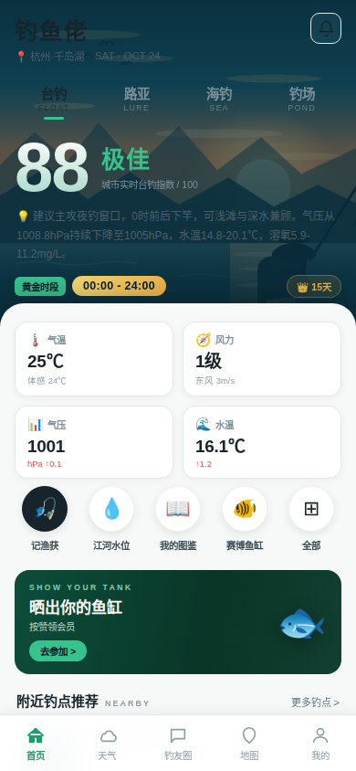
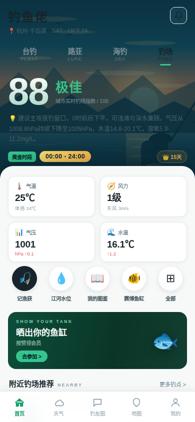
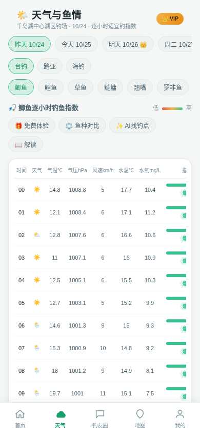

# 🎣 鱼情预报 App（全栈可运行版 · 竞品对齐版 v3.1）

以「鱼情预报」为核心、结合钓点地图与渔获社区的钓鱼 App。
本仓库按《钓鱼鱼情预报 App 需求文档 v1.0》实现的**可运行全栈版本**：后端 API + MySQL 8 数据库 + Redis 缓存 + 移动端 App 界面，一条命令即可启动体验。

**v3.0 竞品对齐版**：在 v2 全部功能不变的前提下，参照竞品将首页重构为**单页聚合首页**——品牌头 + 钓法四段（台钓/路亚/海钓/钓场）+ 大评分区 + 多段黄金时段胶囊 + 动态指标四格 + 五快捷入口 + TANK 横幅 + 附近钓点推荐一屏聚合；底部 Tab 改为 **首页 / 天气 / 钓友圈 / 地图 / 我的**。四格指标随钓法动态切换（路亚看溶氧、海钓看潮汐浪高），海钓模式自动拉取潮汐表并判定涨潮黄金段。既有能力（溶氧透出、15 天鱼口趋势、100 种鱼图鉴、鱼石积分、赛博鱼缸、潮汐查询、钓鱼百科）全部保留（详见「八、追加需求实现清单」）。

**v3.1 视觉统一版**：整体 UI 与首页浅色面板统一（浅灰底 + 白色卡片 + 深色文字 + 绿色强调），并新增全套 DOM 进出场动画——页面切换淡入上移、内容块依次浮现（stagger）、底部 Tab 选中图标弹跳、底部弹层（Sheet）滑入滑出、首页 hero 元素依次入场。地图与登录页保留深青水域色调以维持视觉层次。

## 一、快速启动

```bash
# 1. 安装数据库（如未安装）
sudo apt-get install -y mysql-server redis-server
sudo service mysql start
redis-server --daemonize yes

# 2. 初始化数据库和演示数据
mysql -e "CREATE DATABASE IF NOT EXISTS fishing_app DEFAULT CHARACTER SET utf8mb4;
          CREATE USER IF NOT EXISTS 'fishing'@'localhost' IDENTIFIED WITH mysql_native_password BY 'fishing123';
          GRANT ALL PRIVILEGES ON fishing_app.* TO 'fishing'@'localhost'; FLUSH PRIVILEGES;"
cd backend && npm install && npm run seed

# 3. 构建前端 + 启动后端（单端口 :3000，API 与 App 同源）
cd ../frontend && npm install && npm run build
cd ../backend && npm start
```

启动后访问 **http://localhost:3000**（桌面浏览器中呈现手机壳形态，手机浏览器直接全屏）。

**演示账号**：手机号 `13800138000`，验证码 `123456`（开发模式固定，任何手机号均可登录/自动注册）。

> 也可以使用 `bash start.sh` 一键完成上述步骤。

## 二、界面演示（v3.1 单页聚合首页 · 浅色统一 · 进出场动画）

| 首页 · 台钓 | 首页 · 路亚 |
|---|---|
|  |  |

| 首页 · 海钓 | 首页 · 钓场 |
|---|---|
|  |  |

| 天气与鱼情（含溶氧列） | 底部 Tab：首页/天气/钓友圈/地图/我的 |
|---|---|
|  | 见各首页截图底部导航栏 |

> v2 布局截图（天气预报 / 钓鱼指数 / 钓友圈 / 发现钓点 / 个人中心 / 15 天趋势 / 鱼种图鉴 / 鱼种对比）保留在同目录 `v2-` 前缀文件中；v1 布局截图保留 `1-` ~ `6-` 前缀。
> 单文件交互演示页：`demo.html`（浏览器直接打开，含可点击 Tab 栏与四钓法截图）。

## 三、已实现功能（对照需求文档）

| 文档章节 | 实现情况 |
|---|---|
| FR-01 鱼情预报 | ✅ 逐小时 0-100 开口概率、等级（冷/一般/较好/窗口期）、最佳时间窗、Top 2-3 影响因子解释、免责声明 |
| FR-02 天气与气压 | ✅ 逐小时温度/气压/风速风向/降水/湿度/云量/露点/日出日落/月相；过去 24h 气压趋势曲线；Redis 缓存 TTL 1h + 0-30s jitter，客户端不直连第三方 |
| FR-03 钓点地图 | ✅ 交互地图、Marker 点聚合（缩放 ≥2x）、按水域类型/距离筛选；详情含禁钓状态（红色前置）、可靠性等级、费用、水深、一键导航；UGC 上报+审核数据模型 |
| FR-04 渔获社区 | ✅ 图文动态、鱼种/饵料标签、关联钓点、动态按钓点聚合、评论/点赞/举报；发布主链路机审（高风险拦截/中风险人工队列/低风险先发后审） |
| FR-05 个人渔获日志 | ✅ 日期/钓点/天气快照/饵料/渔获/备注、公开/私密 visibility，自动附带天气快照为模型校准积累数据 |
| FR-06 会员增值 | 📋 v1.1 规划（界面已展示规划说明，MVP 未实现） |
| NFR-01 性能 | ✅ 鱼情接口 P95 ≈ 40ms（≤800ms 红线）；前端构建产物 gzip ≈ 408KB |
| NFR-02 可靠性 | ✅ 天气多数据源降级（和风 API → 模拟器）、缓存雪崩防护、降级结果标注 |
| NFR-03 安全合规 | ✅ JWT 鉴权、登录/发帖限频、UGC 机审主链路、举报入口、权限与隐私说明、预测免责声明 |
| NFR-04 兼容性 | ✅ 移动端视口 + 触控交互 |
| 数据模型 | ✅ 7 张表 + 鱼种配置表，DDL 与文档第六节一致（见 `backend/src/db/schema.sql`） |
| API 契约 | ✅ 第七节全部接口 + 评论/点赞/举报/日志/上传/配置等补充接口（见 `docs/API.md`） |
| 鱼情引擎 v1 | ✅ 第八节六因子加权规则、按鱼种 JSON 配置加鱼种不改代码、快照入库（见 `docs/鱼情引擎说明.md`） |

## 四、技术栈与需求文档的映射

需求文档面向 Flutter + Spring Boot 原生 App。本仓库为**沙箱环境可落地的等价实现**，架构、API 契约、数据模型、算法规则与文档 1:1 对齐，可平滑迁移：

| 需求文档 | 本仓库实现 | 迁移说明 |
|---|---|---|
| Flutter + Dart 3（5 Tab） | React 18 + Vite（同 5 Tab、同交互流程） | API 契约不变，Flutter 端按 `docs/API.md` 重写 UI 即可 |
| Spring Boot 3.4 + JDK 17 | Node.js 22 + Express（Package by Feature） | 模块划分、DTO、异常模型一致；RFC 7807 ProblemDetails 统一错误 |
| MySQL 8 | MySQL 8（schema.sql 即文档 DDL） | 无需迁移 |
| Redis | Redis（ioredis，TTL+jitter，异常降级内存缓存） | 无需迁移 |
| 和风天气 Web API | 同结构客户端 + 内置模拟数据源 | 配置 `HEFENG_API_KEY` 环境变量即切换真实 API，客户端无感 |
| 高德地图 Flutter 插件 | SVG 交互地图（水域底图/Marker/聚合/筛选/导航 URI） | 导航链接即为高德 URI Scheme，Flutter 端换成插件即可 |
| fl_chart | ECharts 5（概率曲线/气压趋势） | 数据接口相同 |
| 阿里云 OSS STS 直传 | 本地 multer 存储，返回结构一致（`{url}`） | 换成 STS 直传即可 |
| 阿里云内容安全 SDK | 可插拔机审服务（敏感词+图片名+确定性抽检） | 换成 SDK 调用即可 |
| 极光 JPush | 用户表预留 `jpush_rid` 字段 | 接入 SDK 即可 |

## 五、目录结构

```
fishing-app/
├── backend/                      # Node.js 后端（Package by Feature）
│   ├── src/
│   │   ├── index.js              # 入口：API + 静态托管 + 统一异常
│   │   ├── config/               # 环境配置
│   │   ├── db/                   # pool / schema.sql / seed
│   │   ├── cache/redis.js        # Redis 封装：TTL+jitter+内存降级
│   │   ├── middleware/           # JWT 鉴权 + RFC 7807 错误处理
│   │   ├── modules/
│   │   │   ├── auth/             # 手机号+验证码登录（JWT）
│   │   │   ├── spots/            # 钓点列表/详情（距离计算）
│   │   │   ├── weather/          # 和风客户端 + 模拟器 + 缓存服务
│   │   │   ├── forecast/         # 鱼情引擎 + 预报服务（三级缓存）
│   │   │   ├── catches/          # 渔获动态 + 内容安全审核
│   │   │   ├── comments/ likes/ reports/ logs/ upload/ config/
│   │   └── utils/                # geo / hash / async-handler
│   └── uploads/                  # 图片存储（OSS 模拟）
├── frontend/                     # React 移动端 App
│   └── src/
│       ├── App.jsx               # 5 Tab 框架 + 登录
│       ├── api.js / store.jsx    # API 客户端（JWT）+ 全局状态
│       ├── theme.css             # 深水色 + 自然绿主题
│       ├── components/           # UI 组件 + ECharts 图表
│       └── pages/                # 预报/钓点/社区/日志/我的/发布
└── docs/
    ├── API.md                    # API 契约
    └── 鱼情引擎说明.md            # 引擎规则与配置
```

## 六、演示动线建议

1. **登录**：手机号 `13800138000` + 验证码 `123456`
2. **首页 Tab**：看大评分/段位 → 切钓法四段（台钓/路亚/海钓/钓场，四格指标随之变化）→ 点黄金时段胶囊看解读 → 五快捷入口（记渔获/江河水位/我的图鉴/赛博鱼缸/全部）→ TANK 横幅 → 附近钓点推荐
3. **天气 Tab**：日期条切换（昨天置灰/明天起 VIP）→ 鱼种 chips →「⚖️ 鱼种对比」叠加 3 种 →「📖 解读」看因子拆解
4. **钓友圈 Tab**：五级筛选 → 六大快捷入口（百科/潮汐/渔具）→ ➕ 发布渔获（+5 鱼石）
5. **地图 Tab**：点 marker 看详情 → 拖拽平移 → 长按地图收藏 → 合规/卫星/历史影像切换
6. **我的 Tab**：战绩四格 →「📖 我的图鉴」看 X/100 → 赛博鱼缸 → 会员卡「开通会员」模拟激活

> 内容安全演示：发布时正文包含「违规测试」将被机审拦截（422）；正常内容即时展示。

## 七、环境变量（backend/.env）

| 变量 | 说明 | 默认 |
|---|---|---|
| `PORT` | 服务端口 | 3000 |
| `DB_*` | MySQL 连接 | fishing/fishing123/fishing_app |
| `REDIS_URL` | Redis 连接 | redis://127.0.0.1:6379 |
| `JWT_SECRET` | JWT 密钥（生产必须更换） | dev-only-secret-change-me |
| `HEFENG_API_KEY` | 和风天气 Key（留空用模拟数据源） | 空 |
| `NODE_ENV` | development 时验证码固定 123456 | development |

## 八、追加需求实现清单（v3.1 竞品对齐版）

在 v1 / v2 全部功能**不变**的前提下，按竞品参考截图实现的追加需求：

### 8.0 单页聚合首页（v3 核心改版）

| 区块 | 实现要点 |
|---|---|
| 品牌头 | 钓鱼佬（楷体）+ 城市·星期·日期（FRI · OCT 23 英文缩写）+ 通知铃铛（通知 Sheet） |
| 钓法四段 | 台钓 FLOAT / 路亚 LURE / 海钓 SEA / 钓场 POND，选中态绿色下划线，切换后鱼种与指标联动重置 |
| 大评分区 | 超大数字评分 + 段位（≥78 极佳 / ≥68 良好 / ≥52 一般）+「城市实时{X}钓指数 /100」+ 💡 AI 建议文案（含气压/水温/溶氧解读） |
| 顶部图片背景 | `frontend/public/hero-bg.svg` 手绘夕阳湖钓剪影插画（天空渐变/太阳光晕/远山两层/湖面波纹/太阳倒影/钓鱼人持竿剪影/飞鸟/芦苇），上叠深青渐变遮罩（.74/.5/.9）保证白字可读，cover 自适应各钓法模式 |
| 黄金时段胶囊 | `goldenSegments()`：逐小时分数提取 ≥68 连续段（容忍 1h 断档），按均分排序取前 3 段，金渐变胶囊 + 👑 15天 入口 |
| 浅色全宽面板 | 顶部 26px 大圆角、-22px 负边距上滑覆盖深色区，内含：动态四格 / 五圆形入口 / TANK 横幅 / 附近钓点 / 今日战报 |
| 动态指标四格 | 面板内 2×2 独立白卡：台钓=气温/风力/气压/水温；路亚=水温/风力/气压/溶氧；海钓=风力/浪高/潮汐/水温；钓场同台钓 |
| 五圆形快捷入口 | 50px 纯圆形图标横排：记渔获（深色圆强调）/ 江河水位（海钓模式自动变「潮汐表」）/ 我的图鉴 / 赛博鱼缸 / 全部 |
| TANK 横幅 | 「SHOW YOUR TANK 晒出你的鱼缸按赞领会员」深绿渐变横幅 + 鱼形插画 |
| 附近钓点推荐 | 缩略图（水域渐变）+ 区域·距离 + ★评分（reliability 映射 5.0/4.8/4.5）+ 价格标签（免费绿色/收费橙色） |
| 底部 Tab（浅色） | 白底 + 细边框 + 阴影，选中项绿色实心图标，未选灰色线条图标 |

### 8.1 底部五 Tab 信息架构（v3：首页 / 天气 / 钓友圈 / 地图 / 我的）

| Tab | 关键布局 | 新增交互 |
|---|---|---|
| 首页（v3 新增） | 单页聚合：品牌头/钓法四段/大评分/黄金时段/动态四格/五入口/TANK 横幅/附近钓点 | 钓法切换、钓点选择 Sheet、江河水位 Sheet（海钓=潮汐表）、通知 Sheet |
| 天气（原钓鱼指数） | 日期条（昨天置灰/明天起 VIP）、三钓法、七鱼种 chips、逐小时表（含水氧 mg/L） | 鱼种对比多系列曲线、解读面板（top 因子） |
| 钓友圈 | 五级筛选（最新/热门/好贴/晒单/城市）、双列瀑布流、双 Banner、六快捷入口 | 百科/渔具/潮汐浮层、晒鱼获 FAB |
| 地图（原发现钓点） | 全屏 SVG 地图、浮动控件组、底部统计条 | 拖拽平移（6px 阈值防误触）、长按 650ms 收藏、卫星/历史影像滤镜、marker 详情 |
| 我的（原个人中心） | 战绩四格、图鉴进度、鱼石、赛博鱼缸、会员卡 | 图鉴 100 宫格、日志合并、桌面小组件说明 |

### 8.2 算法与数据新增

| 能力 | 实现要点 |
|---|---|
| 多段黄金时段提取 | `goldenSegments()`：标记 score≥68 的小时，容忍 1h 断档合并为一段，按段内均分排序取前 3；评分取 `bestWindow.avgScore` |
| 蒲福风级近似 | `windLevel(ms)`：m/s 风速映射 0-12 级文字（无风/软风/轻风……飓风） |
| 钓点评分映射 | reliability 1/2/3 → ★5.0 / 4.8 / 4.5 |
| 水温 EMA 热惯性模型 | `ema += 0.08×(temp-ema)`，全序列均温初始化，日振幅 8℃→1.5℃，叠加深度偏移（水库 2 / 湖泊 1.5 / 河流 1.2 / 黑坑 1 / 近海 0.5） |
| 溶氧 mg/L 估算 | `14.2 - 0.28×水温 + 0.02×(气压-1013) + 0.8×sin(2π(h-15)/24)`，**只透出不进权重** |
| 15 天趋势 | 384 小时模拟（前 24h + 后 15 天），`dayDrift = 2×sin(0.4×day + phase)` 多日缓变；明天起标记 `isVip` |
| 鱼种图鉴 100 种 | `fish_encyclopedia` 表，用户渔获鱼种 ∩ 图鉴自动点亮 |
| 鱼石积分 | users.points，发布渔获 +5，机审拦截不奖励 |
| 潮汐半日潮模型 | `firstHigh = (phase×24.84) % 12.42`，朔望大潮强度 `0.5+0.5×cos(4πp)` |

### 8.3 新增接口（详见 `docs/API.md`）

`GET /forecast?days=1..15`（advice/nextRain/dailyTrend）、`GET /users/me`、`GET /users/me/encyclopedia`、`POST /users/me/vip`、`GET /wiki/articles`、`GET /wiki/gear-shops`、`GET /wiki/tide`、`GET /spots/stats`、`POST /catches`（weightKg + pointsGained）。

### 8.4 部署与穿透（v3 追加）

| 能力 | 实现要点 |
|---|---|
| gzip 穿透加速 | `compression` 中间件：1.26MB 构建产物 → ~415KB 传输，内网穿透场景加载快约 3 倍 |
| 隧道守护 watchdog | 30s 轮询公网链接 + 连续 2 次非 200 才重建（容忍瞬时抖动），后端与隧道分别守护，URL 写入 `/tmp/tunnel-url.txt` |
| 修复 pointer capture 吞点击 | 地图拖拽超 6px 阈值才 `setPointerCapture` + `suppressClickRef` 防误触，点击 marker 不再被拖拽逻辑吞掉 |

### 8.5 迁移说明

`backend/src/db/migrate-002.sql`（users.points / is_vip）与 `migrate-003.sql`（fish_encyclopedia）均为幂等迁移（information_schema 检查 + PREPARE/EXECUTE 动态 ALTER），已在演示库应用；`npm run seed` 会同步灌入 100 种图鉴与鱼石初始值。

### 8.6 视觉统一与进出场动画（v3.1）

**浅色统一**：在 `.page` 作用域内做 **CSS 变量翻转**（把 `--text`/`--bg-card`/`--line` 等重定义为浅色值），使天气 / 钓友圈 / 我的三个内容页自动从深色卡片统一为首页同款浅色面板——浅灰底 `#f4f7f5` + 白卡 + 深色文字 `#17242b` + 绿色强调。地图页与登录页根元素非 `.page`，天然保留深青水域色调，形成「深色 hero/地图 + 浅色内容」的统一层次。各页内联硬编码深色（软格/进度条底）统一替换为 `var(--cell-bg)`，随作用域自动深浅切换（地图详情 Sheet 保持深色，内容页 Sheet 变浅色）。

| 动画 | 触发时机 | 实现 |
|---|---|---|
| 页面入场 `page-fade` | 切换 Tab | `.page` 条件渲染重挂载时自动重播 |
| 内容块依次浮现 `fade-up` | 进入内容页 | `.page > *` 按 nth-child 递增 delay（stagger） |
| 底部 Tab 图标弹跳 `tab-pop` | 选中某 Tab | `.tabbar-item.active svg` |
| 底部弹层滑出 `sheet-out` | 关闭 Sheet | `Sheet` 组件 closing 状态 + 240ms 延迟卸载 |
| 首页 hero 入场 `hero-in` | 进入首页 | `.home-hero` 品牌头/钓法/评分/黄金时段递增 delay |
